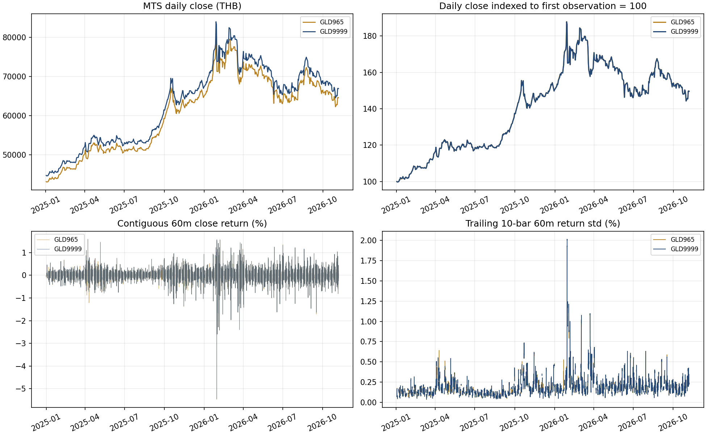
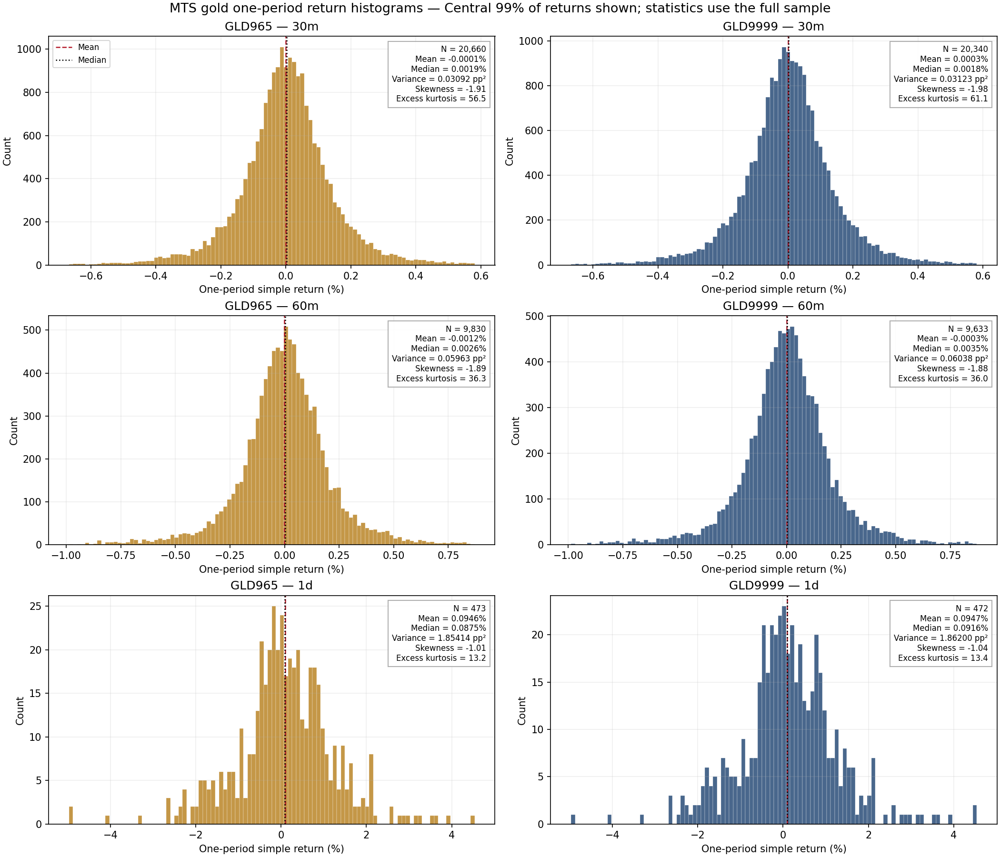
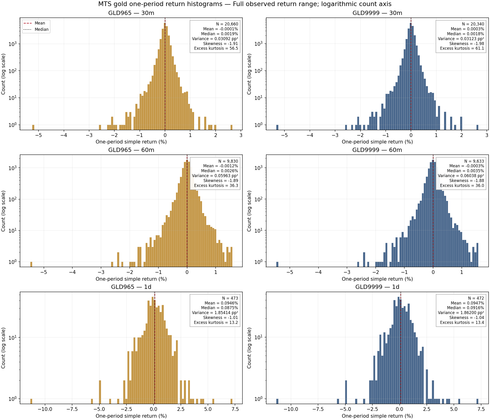

# MTS Gold Forecasting: Dataset and Model Readiness

**Research snapshot:** 7 November 2026 (latest completed MTS daily candle)

**Forecast targets:** direct MTS GLD965 (96.5%) and GLD9999 (99.99%), quoted in THB
**Model intervals under consideration:** 30 minutes and 60 minutes

This document brings together the saved training tables and descriptive analysis. It proposes a first modeling experiment; it does not report fitted-model accuracy. The two MTS purities should be evaluated as separate targets.

## 1. Training data, summary statistics, and null rates

Each row represents information available when an MTS candle completes. The current training label is the **fractional close return to the next contiguous completed candle** of the same purity, `close[t+1]/close[t] − 1`. Rows crossing an intraday gap or the Bangkok-year train/test boundary have no label in the saved training tables. The 2025 portion is reserved for training and chronological validation; 2026 is the held-out test period.

| Interval | Target | Labeled rows | 2025 train | 2026 test | Mean return | Return std | Variance (percentage points²) |
|---|---|---:|---:|---:|---:|---:|---:|
| 30m | GLD965 | 20,659 | 11,122 | 9,537 | −0.0001% | 0.1758% | 0.03092 |
| 30m | GLD9999 | 20,339 | 10,801 | 9,538 | 0.0003% | 0.1767% | 0.03123 |
| 60m | GLD965 | 9,830 | 5,294 | 4,536 | −0.0012% | 0.2442% | 0.05963 |
| 60m | GLD9999 | 9,633 | 5,097 | 4,536 | −0.0003% | 0.2457% | 0.06038 |

The full tables retain **235 numeric candidate input columns** each. A first-pass selection using only 2025 training data keeps **182 columns** with at least 80% non-null values and more than one distinct value. That is a data-quality filter, not proof that all 182 are useful. Features include MTS own/cross price lags, MTS XAU/USD, BTC/USDT, daily US indices and rates, VIX, USD/THB, oil, elapsed-time and source-age fields. Lag orders are 1, 5, and 30 observed bars. Target OHLC in the current completed candle is available for a *next*-candle prediction.

| Example input feature | 2025 train null rate | 2026 test null rate | Implication |
|---|---:|---:|---|
| MTS 30-bar return lag | roughly 0–0.8% | approximately 0% | Ready after initial warm-up. |
| BTC/USDT close | 0% | 0% | Available; its incremental value still needs testing. |
| US 10-year yield daily close | about 2.8% | about 3.1–3.2% | Handle missingness and assumed release timing. |
| Uploaded XAU/USDT 30m/60m close | 94.6–94.8% | 2.3% | Joined and preserved, but excluded from the 2025 baseline feature set. |
| XAUT/USDT close | 100% | 27.3% | Cannot be learned from the 2025 training period. |

Thirty candidate columns are entirely null in 2025 training, largely because XAUT/USDT history begins in March 2026. Uploaded XAU/USDT starts in December 2025; its 60m bars were aggregated from complete 30m pairs. Its venue, volume units, and actual publication time are not yet verified. FRED availability is an assumed observation-date-plus-two-UTC-days, rather than a revision-free historical release record. Never fit an imputer or scaler on 2026 data.

The complete per-column results are in [summary_statistics.csv](../../training_artifacts/summary_statistics.csv) and [null_rates.csv](../../training_artifacts/null_rates.csv). The four paired `X`/`y` dataframes and feature lists are in [training_artifacts](../../training_artifacts/manifest.json).

## 2. Price and return trends

Native daily closes rose about **49.6–49.7%** from the first to last observed candle, but this was not a steady increase. Both purities reached sample-wide intraday peaks in January 2026, followed by peak-to-trough intraday drawdowns of roughly **24%**. A price-level target would therefore mix long-run level movement with large regime changes.

For contiguous intraday pairs, 2026 return variance was approximately **2.5–2.7 times** 2025 variance across the two purities and the 30m/60m intervals. A model with fixed Gaussian error variance is unlikely to describe the entire period well. The line chart shows price levels, normalized prices, 60m returns, and trailing 10-bar 60m return volatility.

The underlying monthly path, exact peak and drawdown dates, and period statistics are in [monthly_price_trend.csv](../reports/monthly_price_trend.csv), [price_extrema_drawdown.csv](../reports/price_extrema_drawdown.csv), and [one_period_return_statistics.csv](../reports/one_period_return_statistics.csv).

## 3. Return histograms and distribution shape

These six histograms show one-period simple returns for GLD965 and GLD9999 at 30m, 60m, and daily intervals. Intraday histograms use only clock-adjacent bars. The central view zooms to the pooled 0.5th–99.5th percentile range at each interval; **all** returns are included in the statistics boxes. The full-range view below uses a logarithmic count axis to reveal rare extremes.

| Target | Interval | Median | Skewness | Excess kurtosis | Interpretation |
|---|---|---:|---:|---:|---|
| GLD965 | 30m | 0.0019% | −1.91 | 56.5 | Heavy negative tail. |
| GLD9999 | 30m | 0.0018% | −1.98 | 61.1 | Heavy negative tail. |
| GLD965 | 60m | 0.0026% | −1.89 | 36.3 | Wider and heavy-tailed. |
| GLD9999 | 60m | 0.0035% | −1.88 | 36.0 | Wider and heavy-tailed. |

Variance in the first table is the sample variance of returns expressed in percentage points squared. Excess kurtosis is zero for a normal distribution; the much higher observed values flag extreme observations. Descriptive statistics alone do not establish predictability.

## 4. Proposed first modeling experiment

1. **Target:** retain the existing simple-return label for comparison, and test next-contiguous-bar **log return**, `y_log = ln(close[t+1]/close[t]) = log1p(y_next_return)`, as the primary dependent variable. Do not model `ln(price)` directly as the main target: it still carries the long-run level trend. Convert a predicted log return to THB with `predicted_price[t+1] = close[t] × exp(predicted_y_log)`.
2. **Four comparable tasks:** GLD965/30m, GLD9999/30m, GLD965/60m, and GLD9999/60m. Keep a separate model or at least a separate evaluation for each; do not randomly pool adjacent observations across targets or intervals.
3. **Chronological evaluation:** develop and tune within 2025 using forward-chaining blocks, then assess once on held-out 2026. Keep any preprocessing, feature selection, standardization, and imputation fitted strictly on each training fold. Honor `available_at` for every input and exclude labels crossing split boundaries.
4. **Feature stages:** start with MTS own/cross return and price lags plus elapsed-time/session indicators. Add MTS XAU/USD, BTC/USDT, FX, rates, indices, and volatility in ablation stages. The XAU/USDT and XAUT/USDT histories are too sparse in 2025 for the first full-period model; study them only after a suitable training history or a separately defined later-period experiment is available. Remove constant and highly redundant fields using training data only.
5. **Baseline before complex models:** compare zero predicted return (unchanged price) with a regularized linear model, then a modest nonlinear tree model. Use trailing moving averages, MA gaps, and rolling volatility as *candidate inputs* computed from already-completed bars. Avoid a moving-average dependent variable initially because smoothing changes the forecast question and can hide extremes.
6. **Scaling and scorecard:** standardize the log-return target with a training-fold mean and standard deviation only when the model benefits; invert this scaling for interpretation. Compare out-of-sample return MAE, price MAE in THB, RMSE, directional accuracy, and tail/regime errors against the zero-return baseline. Report 2025-vs-2026 volatility changes alongside scores; fit no live-trading or position-size rule in this stage.

This is a research design, not a claim of forecast skill. MTS bar completion timestamps and some external release times are nominal. Source revisions and quotes versus executable prices remain limitations for any later live-use assessment.
