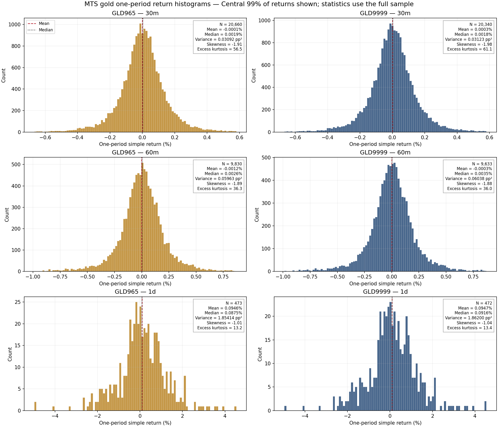
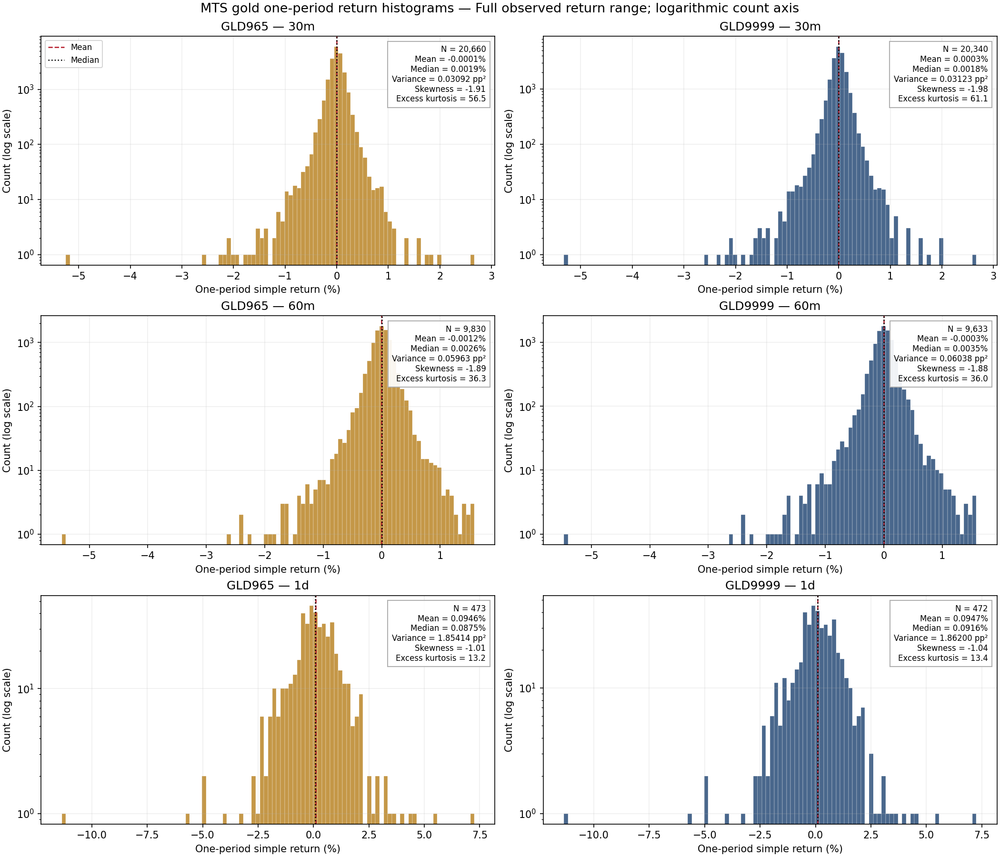
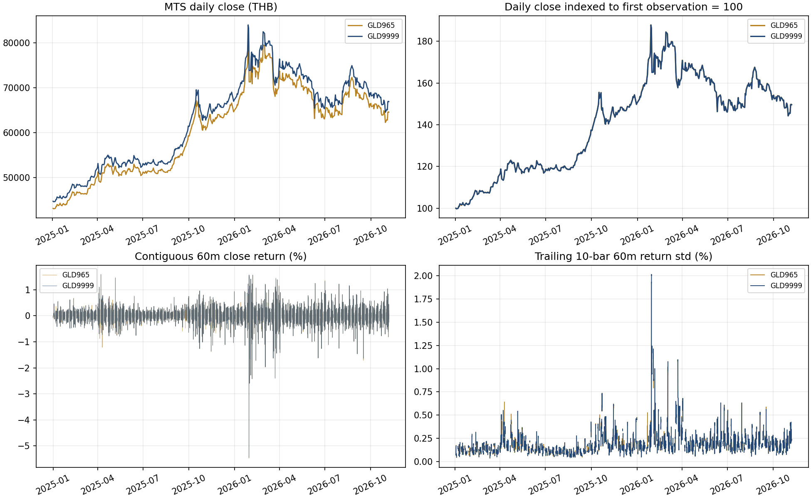

# MTS gold price and return behavior for target design

Source: completed direct MTS GLD965 and GLD9999 chart bars from 2025 through the 7 November 2026 collection cutoff. The modeling focus is 30m and 60m; native daily closes provide long-run context. Intraday `t−1` means the immediately preceding **clock-adjacent** completed bar; pairs separated by a gap are excluded from return/variance calculations. Daily `t−1` means the preceding observed daily candle, including weekends between sessions.

## Price level, peak, bottom and drawdown

| Target | Frame | Bars | First→last close | First→last change | Lowest close (Bangkok) | Highest close (Bangkok) | Max peak-to-trough drawdown |
|---|---|---:|---|---:|---|---|---:|
| GLD965 | 1d | 474 | 43,128→64,548 THB | 49.7% | 43,026 (2025-01-03 07:00) | 81,014 (2026-01-28 07:00) | -23.2% |
| GLD965 | 30m | 21,175 | 42,522→64,548 THB | 51.8% | 42,423 (2025-01-02 06:30) | 81,840 (2026-01-29 13:00) | -24.3% |
| GLD965 | 60m | 10,338 | 42,516→64,548 THB | 51.8% | 42,458 (2025-01-02 07:00) | 81,690 (2026-01-29 08:00) | -24.1% |
| GLD9999 | 1d | 473 | 44,714→66,887 THB | 49.6% | 44,590 (2025-01-03 07:00) | 83,968 (2026-01-28 07:00) | -23.2% |
| GLD9999 | 30m | 20,881 | 44,079→66,887 THB | 51.7% | 43,980 (2025-01-02 06:30) | 84,824 (2026-01-29 13:00) | -24.3% |
| GLD9999 | 60m | 10,162 | 44,071→66,887 THB | 51.8% | 44,007 (2025-01-02 07:00) | 84,666 (2026-01-29 12:00) | -24.2% |

Lowest close is the sample-wide bottom; the maximum drawdown trough can occur at a different time. Exact peak and drawdown-trough timestamps are in `price_extrema_drawdown.csv`. `monthly_price_trend.csv` traces each purity's daily close month by month.

## One-period return and variance

Returns are `close[t]/close[t−1]−1`; log returns are `ln(close[t]/close[t−1])`. Price change in THB is also exported. Variance below is the sample variance of returns expressed in percentage points squared; it is not price-level variance.

| Target | Frame | Year | Return N | Mean | Std | Variance (pp²) | 5th–95th pct | Skew | Excess kurtosis | 10-bar rolling std median/p95 |
|---|---|---|---:|---:|---:|---:|---|---:|---:|---|
| GLD965 | 1d | all | 473 | 0.0946% | 1.3617% | 1.85414 | -1.834% to 1.993% | -1.01 | 13.2 | 0.968% / 2.335% |
| GLD965 | 30m | all | 20,660 | -0.0001% | 0.1758% | 0.03092 | -0.238% to 0.236% | -1.91 | 56.5 | 0.118% / 0.291% |
| GLD965 | 30m | 2025 | 11,123 | 0.0022% | 0.1328% | 0.01763 | -0.197% to 0.198% | -0.72 | 10.3 | 0.099% / 0.240% |
| GLD965 | 30m | 2026 | 9,537 | -0.0028% | 0.2154% | 0.04640 | -0.282% to 0.281% | -2.03 | 51.9 | 0.141% / 0.342% |
| GLD965 | 60m | all | 9,830 | -0.0012% | 0.2442% | 0.05963 | -0.334% to 0.333% | -1.89 | 36.3 | 0.167% / 0.419% |
| GLD965 | 60m | 2025 | 5,294 | 0.0040% | 0.1871% | 0.03502 | -0.274% to 0.276% | -0.41 | 7.0 | 0.135% / 0.349% |
| GLD965 | 60m | 2026 | 4,536 | -0.0074% | 0.2971% | 0.08830 | -0.396% to 0.404% | -2.12 | 33.9 | 0.198% / 0.496% |
| GLD9999 | 1d | all | 472 | 0.0947% | 1.3646% | 1.86200 | -1.835% to 1.974% | -1.04 | 13.4 | 0.958% / 2.340% |
| GLD9999 | 30m | all | 20,340 | 0.0003% | 0.1767% | 0.03123 | -0.235% to 0.238% | -1.98 | 61.1 | 0.118% / 0.293% |
| GLD9999 | 30m | 2025 | 10,802 | 0.0028% | 0.1314% | 0.01727 | -0.195% to 0.197% | -0.57 | 8.4 | 0.099% / 0.237% |
| GLD9999 | 30m | 2026 | 9,538 | -0.0025% | 0.2169% | 0.04703 | -0.280% to 0.281% | -2.12 | 55.4 | 0.142% / 0.346% |
| GLD9999 | 60m | all | 9,633 | -0.0003% | 0.2457% | 0.06038 | -0.329% to 0.334% | -1.88 | 36.0 | 0.169% / 0.421% |
| GLD9999 | 60m | 2025 | 5,097 | 0.0057% | 0.1851% | 0.03426 | -0.267% to 0.278% | -0.36 | 7.1 | 0.136% / 0.343% |
| GLD9999 | 60m | 2026 | 4,536 | -0.0071% | 0.2994% | 0.08965 | -0.401% to 0.404% | -2.07 | 32.8 | 0.198% / 0.508% |

The full `one_period_return_statistics.csv` also gives THB changes, 1st/99th percentiles, zero-return rates, simple versus log-return differences, and lag-1 return/squared-return correlations. Annual summaries assign a return to the current bar's Bangkok year; early-year returns can reference the prior year.

The 2026 intraday return variance is roughly **2.5–2.7×** its 2025 value across the two purities and both selected intervals. The level trend and the return-volatility regime changed together. Simple and log returns differ very little on ordinary intraday bars (mean absolute difference about **0.00015 percentage points** at 30m and **0.00030** at 60m), but both retain extreme observations.

## Return histograms

Each panel includes mean, median, sample variance, skewness and **excess** kurtosis computed from all observed returns. The central view displays the pooled 0.5th–99.5th percentile range within each timeframe so the shape near zero is readable; the full-range view uses a logarithmic count axis to reveal rare extremes. Intraday returns cross no missing-bar gap.

## Modeling decision

- **Preferred dependent variable:** next contiguous 30m or 60m **log return**, `ln(close[t+1]/close[t])`, separately for GLD965 and GLD9999. Predicting raw THB close directly would make the large level trend and differing purity scales dominate the loss. Log return is additive across time and converts to a price forecast as `close[t] × exp(predicted_log_return)`.
- The saved training tables currently use simple `y_next_return`. Convert with `np.log1p(y_next_return)`; the two are close for ordinary bars, while log return handles compounding and large moves more consistently. This transform uses only the future outcome for the label, never as an input.
- **Standardization:** compute the training-period mean and standard deviation of log-return labels, then apply those constants to validation/test labels if the chosen model benefits from scaling. Invert the transform before reporting return or THB errors. Scale input features only with training-fitted parameters.
- **Moving averages:** use trailing MAs, MA gaps, or rolling volatility as possible inputs computed from bars available by decision time. Avoid a smoothed-price dependent variable initially: it changes the forecast question, overlaps heavily across observations, and can hide short-lived extremes. Never use centered MAs.
- Return distributions have extreme tails and changing volatility. Compare against a zero-return/no-change forecast with MAE and robust tail diagnostics; report performance by year and volatility regime. A constant-variance Gaussian error model should be treated as a baseline assumption, not established by these descriptive statistics.
- MTS bar completion times are nominal and historical revisions are possible. This report describes the available sample; it does not establish predictive skill or a live execution price.

