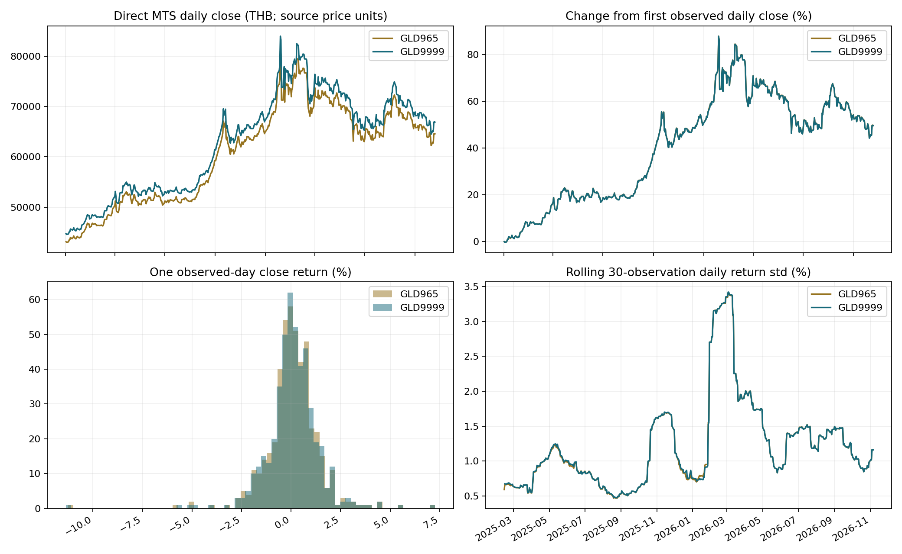
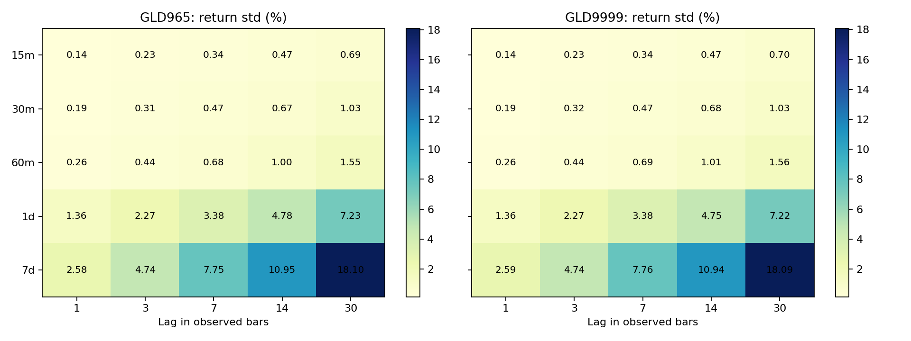

# MTS Gold: historical data and return analysis

Analysis as of **2026-11-07T06:16:11.127745+00:00**.

Requested window: 2024-12-31T17:00:00+00:00 to 2026-12-31T17:00:00+00:00 (exclusive).
Effective collection cutoff: 2026-11-07T06:16:11+00:00. No future observations are included.

Source: [MTS public chart](https://tradingview.mtsgold.co.th/mgb/chart/), using its `/mgb/history` UDF endpoint.
GLD965 is 96.5%; GLD9999 is 99.99% (confirmed by the user). Both source symbols quote THB.
The endpoint does not publish the weight basis or whether OHLC represents bid, ask, or mid. These are chart-price returns, not executable trade P&L.

## Coverage

| Symbol | Timeframe | Closed bars | First timestamp (UTC) | Last timestamp (UTC) | Partial intraday buckets dropped |
|---|---|---:|---|---|---:|
| GLD965 | 15m | 42,803 | 2024-12-31T17:00:00+00:00 | 2026-11-06T21:45:00+00:00 | 0 |
| GLD965 | 30m | 21,175 | 2024-12-31T17:00:00+00:00 | 2026-11-06T21:30:00+00:00 | 453 |
| GLD965 | 60m | 10,338 | 2024-12-31T17:00:00+00:00 | 2026-11-06T21:00:00+00:00 | 529 |
| GLD965 | 1d | 474 | 2025-01-02T00:00:00+00:00 | 2026-11-06T00:00:00+00:00 | 0 |
| GLD965 | 7d | 95 | 2025-01-06T00:00:00+00:00 | 2026-10-26T00:00:00+00:00 | 0 |
| GLD9999 | 15m | 42,300 | 2024-12-31T17:00:00+00:00 | 2026-11-06T21:45:00+00:00 | 0 |
| GLD9999 | 30m | 20,881 | 2024-12-31T17:00:00+00:00 | 2026-11-06T21:30:00+00:00 | 538 |
| GLD9999 | 60m | 10,162 | 2024-12-31T17:00:00+00:00 | 2026-11-06T21:00:00+00:00 | 635 |
| GLD9999 | 1d | 473 | 2025-01-02T00:00:00+00:00 | 2026-11-06T00:00:00+00:00 | 0 |
| GLD9999 | 7d | 95 | 2025-01-06T00:00:00+00:00 | 2026-10-26T00:00:00+00:00 | 0 |

## Returns

`R(t,k) = close(t) / close(t-k) - 1`; `log_R(t,k) = ln(close(t) / close(t-k))`.
Lags 1, 3, 7, 14, 30 count observed bars separately in each timeframe. Intraday lags may cross overnight/weekend gaps; elapsed minutes are exported for every lag.
Daily lags count observed daily candles. Seven-day bars are Monday-to-Monday calendar weeks, not rolling seven trading sessions.
Returns in the data are decimal fractions; the table and summary columns ending `_pct` are percentages.

| Symbol | Timeframe | Lag (bars) | N | Mean (%) | Std (%) | 5th pct (%) | 95th pct (%) | Median elapsed (minutes) |
|---|---|---:|---:|---:|---:|---:|---:|---:|
| GLD965 | 15m | 1 | 42,802 | 0.0011 | 0.1353 | -0.1757 | 0.1760 | 15 |
| GLD965 | 15m | 3 | 42,800 | 0.0032 | 0.2261 | -0.2923 | 0.2960 | 45 |
| GLD965 | 15m | 7 | 42,796 | 0.0074 | 0.3380 | -0.4457 | 0.4725 | 105 |
| GLD965 | 15m | 14 | 42,789 | 0.0148 | 0.4707 | -0.6379 | 0.6864 | 210 |
| GLD965 | 15m | 30 | 42,773 | 0.0316 | 0.6942 | -0.9947 | 1.0503 | 450 |
| GLD965 | 1d | 1 | 473 | 0.0946 | 1.3617 | -1.8342 | 1.9935 | 1440 |
| GLD965 | 1d | 3 | 471 | 0.2839 | 2.2672 | -2.7912 | 3.8390 | 7200 |
| GLD965 | 1d | 7 | 467 | 0.6331 | 3.3845 | -3.9280 | 6.2350 | 12960 |
| GLD965 | 1d | 14 | 460 | 1.2894 | 4.7790 | -6.2545 | 8.5899 | 28800 |
| GLD965 | 1d | 30 | 444 | 2.8723 | 7.2271 | -7.8986 | 15.3038 | 60480 |
| GLD965 | 30m | 1 | 21,174 | 0.0021 | 0.1859 | -0.2399 | 0.2448 | 30 |
| GLD965 | 30m | 3 | 21,172 | 0.0064 | 0.3146 | -0.4093 | 0.4275 | 90 |
| GLD965 | 30m | 7 | 21,168 | 0.0149 | 0.4712 | -0.6412 | 0.6833 | 210 |
| GLD965 | 30m | 14 | 21,161 | 0.0298 | 0.6734 | -0.9574 | 1.0178 | 420 |
| GLD965 | 30m | 30 | 21,145 | 0.0643 | 1.0282 | -1.4900 | 1.5385 | 990 |
| GLD965 | 60m | 1 | 10,337 | 0.0044 | 0.2603 | -0.3397 | 0.3602 | 60 |
| GLD965 | 60m | 3 | 10,335 | 0.0131 | 0.4387 | -0.6012 | 0.6334 | 180 |
| GLD965 | 60m | 7 | 10,331 | 0.0306 | 0.6822 | -0.9682 | 1.0439 | 420 |
| GLD965 | 60m | 14 | 10,324 | 0.0614 | 1.0021 | -1.4469 | 1.5052 | 960 |
| GLD965 | 60m | 30 | 10,308 | 0.1316 | 1.5467 | -2.2247 | 2.3726 | 2040 |
| GLD965 | 7d | 1 | 94 | 0.4028 | 2.5837 | -3.3525 | 4.4756 | 10080 |
| GLD965 | 7d | 3 | 92 | 1.3429 | 4.7391 | -6.1834 | 8.9084 | 30240 |
| GLD965 | 7d | 7 | 88 | 3.3490 | 7.7549 | -8.1647 | 16.2573 | 70560 |
| GLD965 | 7d | 14 | 81 | 7.0209 | 10.9481 | -10.5444 | 22.4491 | 141120 |
| GLD965 | 7d | 30 | 65 | 17.1976 | 18.0963 | -12.4811 | 47.4791 | 302400 |
| GLD9999 | 15m | 1 | 42,299 | 0.0011 | 0.1351 | -0.1760 | 0.1764 | 15 |
| GLD9999 | 15m | 3 | 42,297 | 0.0032 | 0.2268 | -0.2921 | 0.2970 | 45 |
| GLD9999 | 15m | 7 | 42,293 | 0.0075 | 0.3391 | -0.4481 | 0.4726 | 105 |
| GLD9999 | 15m | 14 | 42,286 | 0.0149 | 0.4729 | -0.6406 | 0.6919 | 210 |
| GLD9999 | 15m | 30 | 42,270 | 0.0320 | 0.7004 | -1.0035 | 1.0593 | 450 |
| GLD9999 | 1d | 1 | 472 | 0.0947 | 1.3646 | -1.8350 | 1.9737 | 1440 |
| GLD9999 | 1d | 3 | 470 | 0.2843 | 2.2699 | -2.7941 | 3.8412 | 7200 |
| GLD9999 | 1d | 7 | 466 | 0.6336 | 3.3819 | -3.9371 | 6.2429 | 12960 |
| GLD9999 | 1d | 14 | 459 | 1.2878 | 4.7544 | -6.2671 | 8.5917 | 28800 |
| GLD9999 | 1d | 30 | 443 | 2.8601 | 7.2176 | -7.9101 | 15.0894 | 60480 |
| GLD9999 | 30m | 1 | 20,880 | 0.0022 | 0.1855 | -0.2391 | 0.2449 | 30 |
| GLD9999 | 30m | 3 | 20,878 | 0.0065 | 0.3154 | -0.4110 | 0.4284 | 90 |
| GLD9999 | 30m | 7 | 20,874 | 0.0151 | 0.4737 | -0.6428 | 0.6902 | 210 |
| GLD9999 | 30m | 14 | 20,867 | 0.0302 | 0.6799 | -0.9703 | 1.0337 | 420 |
| GLD9999 | 30m | 30 | 20,851 | 0.0650 | 1.0318 | -1.5181 | 1.5502 | 990 |
| GLD9999 | 60m | 1 | 10,161 | 0.0044 | 0.2600 | -0.3394 | 0.3616 | 60 |
| GLD9999 | 60m | 3 | 10,159 | 0.0133 | 0.4416 | -0.6085 | 0.6428 | 180 |
| GLD9999 | 60m | 7 | 10,155 | 0.0311 | 0.6884 | -0.9809 | 1.0552 | 420 |
| GLD9999 | 60m | 14 | 10,148 | 0.0623 | 1.0064 | -1.4515 | 1.5247 | 960 |
| GLD9999 | 60m | 30 | 10,132 | 0.1333 | 1.5550 | -2.2600 | 2.3941 | 2040 |
| GLD9999 | 7d | 1 | 94 | 0.4013 | 2.5931 | -3.3439 | 4.5099 | 10080 |
| GLD9999 | 7d | 3 | 92 | 1.3404 | 4.7414 | -6.1788 | 8.9050 | 30240 |
| GLD9999 | 7d | 7 | 88 | 3.3449 | 7.7561 | -8.1695 | 16.3957 | 70560 |
| GLD9999 | 7d | 14 | 81 | 7.0134 | 10.9398 | -10.5567 | 22.4292 | 141120 |
| GLD9999 | 7d | 30 | 65 | 17.1829 | 18.0871 | -12.4889 | 47.4762 | 302400 |

## Findings

- GLD965: one-observation daily return standard deviation rose from **0.921% in 2025** to **1.737% in available 2026**, a 1.89x change. The model should be evaluated across this volatility change.
- GLD965: daily returns ranged from **-11.26%** to **7.25%**; sample excess kurtosis was **13.21**. Large tails in this sample make a normal-error assumption questionable.
- GLD9999: one-observation daily return standard deviation rose from **0.930% in 2025** to **1.732% in available 2026**, a 1.86x change. The model should be evaluated across this volatility change.
- GLD9999: daily returns ranged from **-11.36%** to **7.26%**; sample excess kurtosis was **13.45**. Large tails in this sample make a normal-error assumption questionable.
- On 471 shared consecutive daily observation pairs, the two series' return correlation was **0.99983**. Returns are recomputed after matching close dates so each comparison spans the same interval; the two gold series carry strongly overlapping daily price information.
- There are **3 daily dates** on which only one gold series has a source candle; see `daily_alignment_gaps.csv`. These dates should be checked before cross-series model features are joined.
- The 30-week return has only 65, 65 observations for the two series, and these returns overlap heavily. Its descriptive mean should not be interpreted as a stable expected return.

## Observed period movement

- GLD965, 2025: 255 daily candles; first-to-last observed close change **50.42%**. This is within-year observed movement, not a full calendar-year return.
- GLD965, 2026: 219 daily candles; first-to-last observed close change **-0.98%**. This is within-year observed movement, not a full calendar-year return.
- GLD9999, 2025: 253 daily candles; first-to-last observed close change **50.37%**. This is within-year observed movement, not a full calendar-year return.
- GLD9999, 2026: 220 daily candles; first-to-last observed close change **-1.00%**. This is within-year observed movement, not a full calendar-year return.

## Method and limitations

- Native 15-minute and daily OHLC come directly from MTS. The 30/60-minute bars require all constituent 15-minute candles; incomplete buckets are dropped. No prices or closed-market periods are filled.
- Daily timestamps are UTC midnight, or 07:00 Bangkok. Daily availability is conservatively the next UTC midnight. Weekly bars aggregate native daily OHLC, anchored to Monday 07:00 Bangkok, and are available only after the full week ends. The first truncated week is excluded.
- `available_at` is a nominal candle-completion boundary, not a measured historical publication timestamp. A historical download may contain source revisions; it is not a point-in-time vintage archive.
- Source session metadata is preserved but not used to erase observations: observed bars can extend beyond its advertised hours. Gaps combine closures, holidays and possible outages; without a verified historical calendar they are not classified as missing trading bars.
- Leading lag values have no pre-2025 warm-up and remain missing. A 30-bar weekly return needs 30 earlier weeks. The current partial candle/week and the unelapsed remainder of 2026 are excluded.
- Per-year summaries use the current bar's Bangkok year; early-2026 lagged returns can reference 2025 prices. Full-period results pool both years.
- Multi-bar returns overlap. Their sample count is not an independent sample size; these descriptive statistics do not establish predictability or statistical significance. No square-root-time annualization is assumed.
- Tidewatch's existing `GOLD965THB@mts` and `GOLD9999USD@mts` are synthetic proxies. These direct THB series are kept separately as GLD965/GLD9999, without replacing production IDs or claiming equivalence to the USD synthetic.
- For the later forecast stage: use chronological 2025 training and 2026 evaluation, fit preprocessing only on training data, and purge overlapping forward labels at split boundaries. Compare against a no-change price baseline. Current work collects data and analyzes past returns; it does not train a model.

## Artifacts

- `return_summary.csv`: all lags, timeframes, and separate 2025/2026/full-period summaries.
- `coverage.csv`: observed gaps, flat prices and discarded partial intraday buckets.
- `daily_alignment_gaps.csv`: source daily dates present for only one gold series.
- `../data/bars.csv` and `../data/returns.csv.gz`: normalized candles and every simple/log return, with elapsed minutes.
- `../data/manifest.json`, `source_metadata.json`, and `raw/`: exact requests, retrieval times, raw-response hashes and reusable cached responses.

