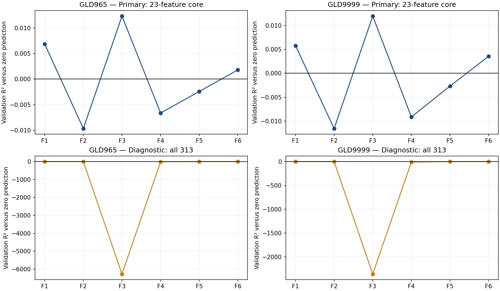
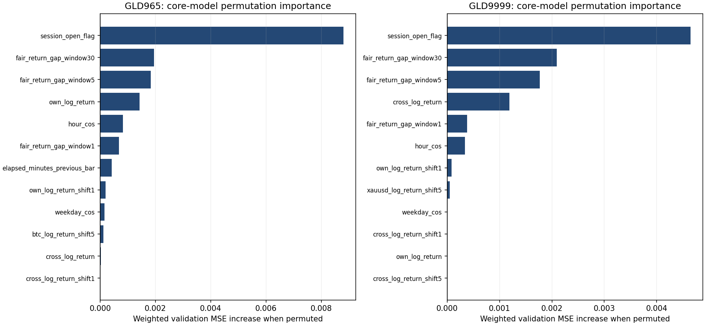

# Model 1 baseline and manual feature review

## Purpose and scope

This run predicts the clipped volatility-scaled next-hour log return separately for GLD965 and GLD9999. Six expanding chronological folds span the available 2025–2026 history. There is no fixed year split and no separate untouched final test set in this run. After these validation results inform manual feature selection, they are development evidence, not a fresh final test.

No feature has been removed from the candidate files. The primary model uses the predeclared **23-feature core**; an explicitly secondary **313-feature diagnostic model** supplies permutation importance for the wider candidate set. This wider model is not a replacement for the compact baseline. All-null and constant input columns remain in the diagnostic estimator schema.

## Fixed, untuned model and label

Both fitted estimators are Elastic Net with alpha=0.01, l1_ratio=0.5, max_iter=10,000, tol=1e-5 and an intercept. There was no hyperparameter search. The EWMA half-life is fixed at 30 observed returns; its variance seed is fitted separately from each fold's training returns. The target is `z = clip(next_log_return / sigma_t, -5, 5)`. Training-fold medians fill missing X values; entirely missing columns use zero. StandardScaler is fitted only on the fold's training rows.

Model 2 has not been fitted. Exported return/price forecasts use the current trailing sigma solely as a labeled persistence-rescaling diagnostic; they are not the final two-model combination.

## Out-of-fold results

R² here is `1 − sum((z − z_hat)^2)/sum(z^2)`, relative to the zero predictor. Positive MSE improvement means a better forecast. The 95% interval uses 1,000 paired circular block-bootstrap samples of 30 validation observations within each fold. The acceptance rule requires the lower MSE-improvement bound to exceed zero.

| symbol | model | r2 vs zero | mse improvement ci low | mse improvement ci high | decision |
|---|---|---|---|---|---|
| GLD965 | Core (23) | 0.00020 | -0.00555 | 0.00604 | does not pass CI rule |
| GLD965 | Diagnostic (313) | -1132.50159 | -2328.36693 | -448.86341 | does not pass CI rule |
| GLD9999 | Core (23) | -0.00086 | -0.00659 | 0.00461 | does not pass CI rule |
| GLD9999 | Diagnostic (313) | -431.99648 | -940.42911 | -172.36268 | does not pass CI rule |

The primary core model does not establish a reliable improvement over zero if its interval straddles zero, even when the point R² or conditional directional accuracy is positive. The all-candidate model is a stress test of retaining every input, including sparse ones; large negative scores are preserved without clipping or tuning.

**Diagnostic failure analysis:** the expanded model extrapolates far beyond some fold-training feature ranges. In particular, sparse uploaded XAU/USDT volume histories can have a very small training scale and much larger later observations. The table below shows the largest validation standardized values among inputs with nonzero fitted coefficients; `worst_prediction_contributions` traces the resulting forecast errors to individual terms. All-null training inputs have zero coefficients and cannot explain these errors, even if their later standardized values are large. This is a reason for manual source/feature review, not an automatic deletion or a post-hoc prediction cap.

| symbol | fold | feature | train observed count | max abs standardized validation |
|---|---|---|---|---|
| GLD965 | F3 | xauusdt_60m_volume_lag30 | 248 | 21611.32062 |
| GLD9999 | F3 | xauusdt_60m_volume_lag30 | 247 | 21208.07942 |
| GLD965 | F3 | xauusdt_60m_volume_lag5 | 270 | 13388.91176 |
| GLD9999 | F3 | xauusdt_60m_volume_lag5 | 269 | 13148.59637 |
| GLD965 | F3 | xauusdt_60m_volume_lag1 | 274 | 12816.69184 |
| GLD9999 | F3 | xauusdt_60m_volume_lag1 | 273 | 12583.55622 |

Directional accuracy excludes abs(z_hat) <= 0.05 and realized zero returns; its prediction coverage is always reported. The bootstrap interval is for model loss improvement, not for individual permutation ranks. The two purities are strongly correlated and do not count as independent confirmations.

## Chronological fold design

Every fold begins training on 1 January 2025. Training expands to each listed end. A seven-calendar-day gap precedes validation, and the helper verifies at least 30 observed context bars in that gap. Labels crossing train/validation end boundaries are removed. Observed returns in the embargo update the EWMA state causally, without fitting estimator parameters.

| symbol | fold | train end | validation start | validation end | train rows | validation rows | embargo context bars |
|---|---|---|---|---|---|---|---|
| GLD965 | F1 | 2025-07-01 | 2025-07-08 | 2025-10-01 | 2603 | 1251 | 107 |
| GLD965 | F2 | 2025-10-01 | 2025-10-08 | 2026-01-01 | 3957 | 1234 | 108 |
| GLD965 | F3 | 2026-01-01 | 2026-01-08 | 2026-04-01 | 5294 | 1218 | 87 |
| GLD965 | F4 | 2026-04-01 | 2026-04-08 | 2026-07-01 | 6594 | 1232 | 87 |
| GLD965 | F5 | 2026-07-01 | 2026-07-08 | 2026-10-01 | 7910 | 1255 | 105 |
| GLD965 | F6 | 2026-10-01 | 2026-10-08 | 2026-11-08 | 9266 | 463 | 106 |
| GLD9999 | F1 | 2025-07-01 | 2025-07-08 | 2025-10-01 | 2488 | 1183 | 105 |
| GLD9999 | F2 | 2025-10-01 | 2025-10-08 | 2026-01-01 | 3772 | 1222 | 108 |
| GLD9999 | F3 | 2026-01-01 | 2026-01-08 | 2026-04-01 | 5097 | 1219 | 87 |
| GLD9999 | F4 | 2026-04-01 | 2026-04-08 | 2026-07-01 | 6398 | 1232 | 87 |
| GLD9999 | F5 | 2026-07-01 | 2026-07-08 | 2026-10-01 | 7714 | 1254 | 105 |
| GLD9999 | F6 | 2026-10-01 | 2026-10-08 | 2026-11-08 | 9069 | 463 | 106 |

## Feature diagnostics: review only

Null rates and sample variances are calculated from the actual training rows in each fold, before imputation. A null rate **>=20%** is flagged, including exactly 20%. A column with one observed unique value has zero variance. Entirely missing columns are separately identified; their variance is undefined, not zero.

| symbol | fold | null ge 20pct | all null | zero variance |
|---|---|---|---|---|
| GLD965 | F1 | 80 | 45 | 8 |
| GLD965 | F2 | 47 | 45 | 8 |
| GLD965 | F3 | 47 | 30 | 12 |
| GLD965 | F4 | 47 | 8 | 17 |
| GLD965 | F5 | 47 | 0 | 19 |
| GLD965 | F6 | 47 | 0 | 19 |
| GLD9999 | F1 | 80 | 45 | 8 |
| GLD9999 | F2 | 47 | 45 | 8 |
| GLD9999 | F3 | 47 | 30 | 12 |
| GLD9999 | F4 | 47 | 8 | 17 |
| GLD9999 | F5 | 47 | 0 | 19 |
| GLD9999 | F6 | 47 | 0 | 19 |

**VIF:** both core-only and all-candidate scopes are reported. Train-median-imputed nonconstant columns define the correlation matrix. Undefined values for all-null/constant columns remain in the exported rows. Numerically singular dependencies are marked `inf`; warnings are >=5 and severe flags >=10. Correlation rank and tolerance are exported. No variable is iteratively deleted to reduce VIF.

**VARCLUS:** the varclushi implementation uses PCA/quartimax splitting with a second-eigenvalue threshold of 1.0, no cluster-count cap and zero random starts. It uses training X only. For each candidate it reports its cluster, R² with its own cluster, R² with the nearest other cluster and `(1−R²_own)/(1−R²_nearest)`. The smallest ratio suggests a representative for your review. Cluster numbers are local to a fold and cannot be compared as stable IDs. Constants/all-null fields are mathematically ineligible for correlation clustering but remain in the dataset and review sheet.

**Permutation importance:** evaluated on validation rows after training-fitted preprocessing, with 20 block-permutation repeats per feature. Positive values indicate increased MSE when that feature is disrupted. Correlated substitutes can each look unimportant. Repeat standard deviations and p05/p95 are dispersion measures, not confidence intervals for statistical significance. Zero importance can mean a zero Elastic Net coefficient; it does not prove the feature lacks value for every model.

## Manual decision and model development solution

1. Review `manual_review` in the Excel workbook. It has editable `manual_decision` (keep/drop/review) and `manual_notes` fields. Nothing has been automatically removed. Use fold-to-fold stability, source quality and economic interpretation alongside flags.
2. First review features that are repeatedly >=20% missing, entirely absent, or constant. Missing gold references that only appear late in the sample should not be judged as if they were available throughout training.
3. Review clusters and VIF together to find redundant groups. Prefer interpretable, timely representatives, but do not blindly remove variables solely because a regularized linear model has high VIF or near-zero permutation importance.
4. Use the compact baseline as the main reference. Any selected-feature experiment must be evaluated with nested chronological selection or a later unexamined period; selecting on these validation importance results and reusing the same scores would be optimistic.
5. If the core model fails the positive-CI acceptance rule, retain zero as the accepted directional baseline. The trained models are still saved for inspection. Do not tune until the manual feature shortlist and evaluation protocol are fixed.
6. Build the volatility model next with its own persistence-sigma comparison and train-fitted bias/magnitude calibration. Only then evaluate the full proposed rescaling against the natural inverse using current sigma. Report errors by volatility regime and Bangkok hour; the current workbook already supplies those diagnostics for Model 1.

## Files and reproducibility

`Model1_Training_Baseline.ipynb` executes the reproducible experiment. `Model1_Baseline_Review.xlsx` contains settings, hashes, schedules, metrics, null/variance, VIF, VARCLUS, coefficients, permutation results and all validation predictions. `model1_results/` preserves corresponding CSVs, fitted linear-model parameters/preprocessing, charts and a versioned run manifest. The initial candidate CSV files are unchanged.

The source MTS prices end in early November 2026. MTS completion timestamps and FRED release delays are nominal rather than verified historical release vintages. Full-period candidate diagnostics are computed separately for each fold's training portion; future values are never used to fit its preprocessing.
