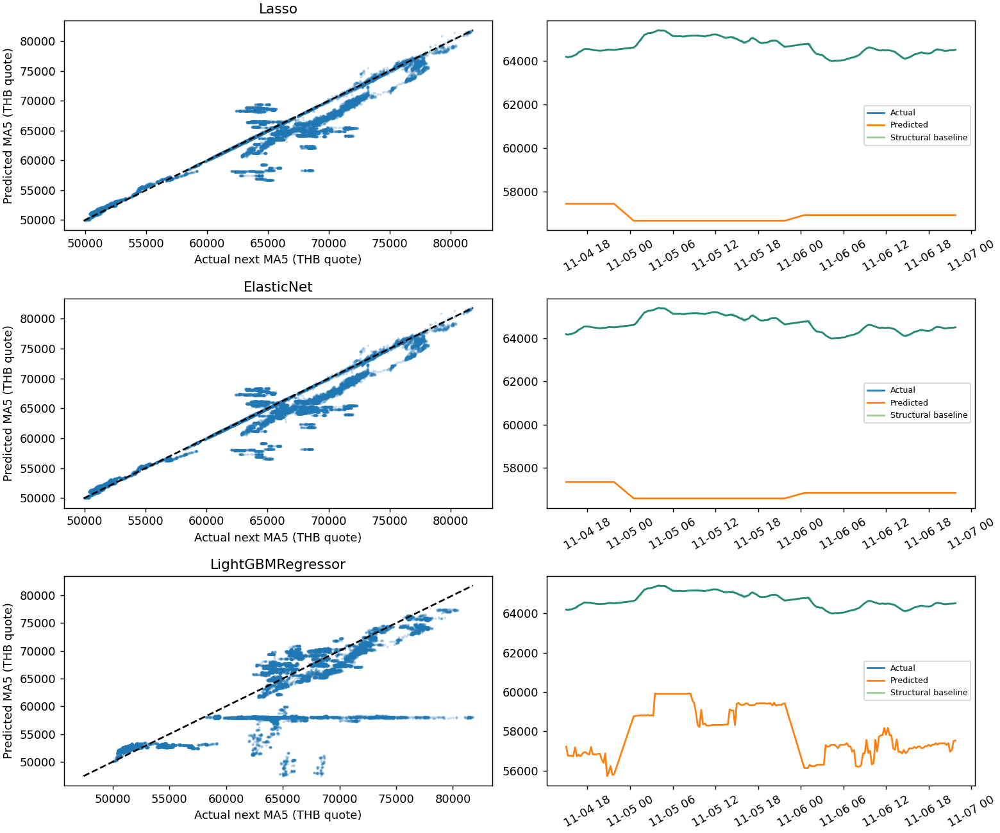

# GLD965 15m: next-bar MA5 price forecast

Y(t+1) = [P(t-3)+P(t-2)+P(t-1)+P(t)+P(t+1)]/5. Decisions occur after bar t completes. This forecasts the next trailing five-bar average, rather than the average of five entirely future bars. Both the current and next five-bar windows must be contiguous 15-minute observations; session gaps and unmatured boundary labels are excluded. All price errors use original THB quote units.

## Design

The previous 15m lag-only feature design is retained: 196 candidates including fold-seeded Z_return_lag5, lagged source prices/returns/volumes and lagged rolling return moments. Drop null rate >=20%, zero variance, retain three candidates per VARCLUS cluster by smallest R-squared ratio, iteratively remove the largest VIF >10, then retain up to 45 by Lasso block-permutation importance. These are fold-local decisions. This experiment changes the target; it does not implement the previously suggested feature-timing ablations.

Four outer TimeSeriesSplit folds use 30 context bars of embargo. Inside each outer training window, the first 60% fits diagnostics and preprocessing, the next 20% ranks permutation importance, and the final 20% tunes hyperparameters, with 30-bar gaps. Each label must mature within its segment. Selected features and winning models are refitted on outer training only. Target mean and standard deviation are fitted on training labels only, independently for inner and outer fits; predictions are inverted to price units. This scaling keeps the previous regularization grids comparable. EWMA is used only for the historical Z lag input.

## Baselines and interpretation

Structural persistence predicts [P(t-3)+P(t-2)+P(t-1)+2*P(t)]/5, obtained by assuming P(t+1)=P(t). MA persistence predicts MA5(t). Price persistence predicts P(t); training mean predicts the fold-training target mean. Four of five target closes are already known at decision time. High conventional price-level R2 therefore does not demonstrate return predictability. Structural-baseline error equals [P(t+1)-P(t)]/5. Skill against this baseline is the principal measure; zero skill matches it.

## Out-of-fold results

| Model                  |       RMSE |        MAE |        R2 |   Skill vs structural |     Gain CI low |    Gain CI high |
|:-----------------------|-----------:|-----------:|----------:|----------------------:|----------------:|----------------:|
| ElasticNet             |  2290.33   |  1462.18   |  0.913737 |          -15273.4     |    -5.74392e+06 |    -4.75843e+06 |
| Lasso                  |  2326.59   |  1504.64   |  0.910984 |          -15760.9     |    -5.91121e+06 |    -4.92782e+06 |
| LightGBMRegressor      |  5117.16   |  3427.83   |  0.569389 |          -76246.7     |    -2.94151e+07 |    -2.32368e+07 |
| MA_persistence         |    40.3948 |    23.9935 |  0.999973 |              -3.75138 | -1608.3         | -1036.35        |
| price_persistence      |    71.2045 |    42.0287 |  0.999917 |             -13.7633  | -5846.97        | -3918.01        |
| structural_persistence |    18.5317 |    11.0884 |  0.999994 |               0       |     0           |     0           |
| train_mean             | 12453.9    | 10870.6    | -1.55059  |         -451628       |    -1.61359e+08 |    -1.49023e+08 |

## Result interpretation

Structural persistence has RMSE 18.53 THB quote units. The best fitted model, Elastic Net, has RMSE 2,290.33. All fitted models perform worse than structural persistence; their gain confidence intervals are negative. The known four-price component makes persistence especially strong. High conventional price-level R2 does not establish forecasting skill. Regularization, lag-only inputs and price-level extrapolation can leave fitted levels far from recent quotes; inspect fold train/validation metrics.

The 95% intervals are paired circular block-bootstrap intervals of MSE improvement against structural persistence: 1,000 samples of 30 observations within folds. A positive lower bound is required to claim improvement. Pairwise comparisons are exploratory, without multiple-comparison correction. Train and validation scores are exported separately.

## Waterfall survivors

| stage                            |   1 |   2 |   3 |   4 |
|:---------------------------------|----:|----:|----:|----:|
| 1 strictly lagged inputs         | 196 | 196 | 196 | 196 |
| 2 null >=20%                     | 129 | 133 | 139 | 166 |
| 3 zero variance                  | 121 | 125 | 131 | 158 |
| 4 VARCLUS top 3 per cluster      |  76 |  72 |  72 |  98 |
| 5 iterative VIF >10              |  46 |  48 |  53 |  60 |
| 6 Lasso permutation top up to 45 |  45 |  45 |  45 |  45 |

## Limits and next steps

This is a price-level task and its R2 cannot be compared directly with the earlier return-target R2. LightGBM trees may struggle to extrapolate price levels above their training range. The retained lag-only rule excludes the freshest completed return and synchronized current references. A fixed top-45 list can include zero or negative permutation importance. Daily macro release timing is assumed; gold-reference coverage remains uneven. These are development folds across 2025–2026, with no untouched final holdout after inspection. Plot timestamps are UTC.

Before changing the target again, compare errors with structural persistence and inspect fold-specific train/validation gaps. A residual experiment forecasting the unknown next-price innovation can distinguish learning future moves from reconstructing the known part of this moving average.
