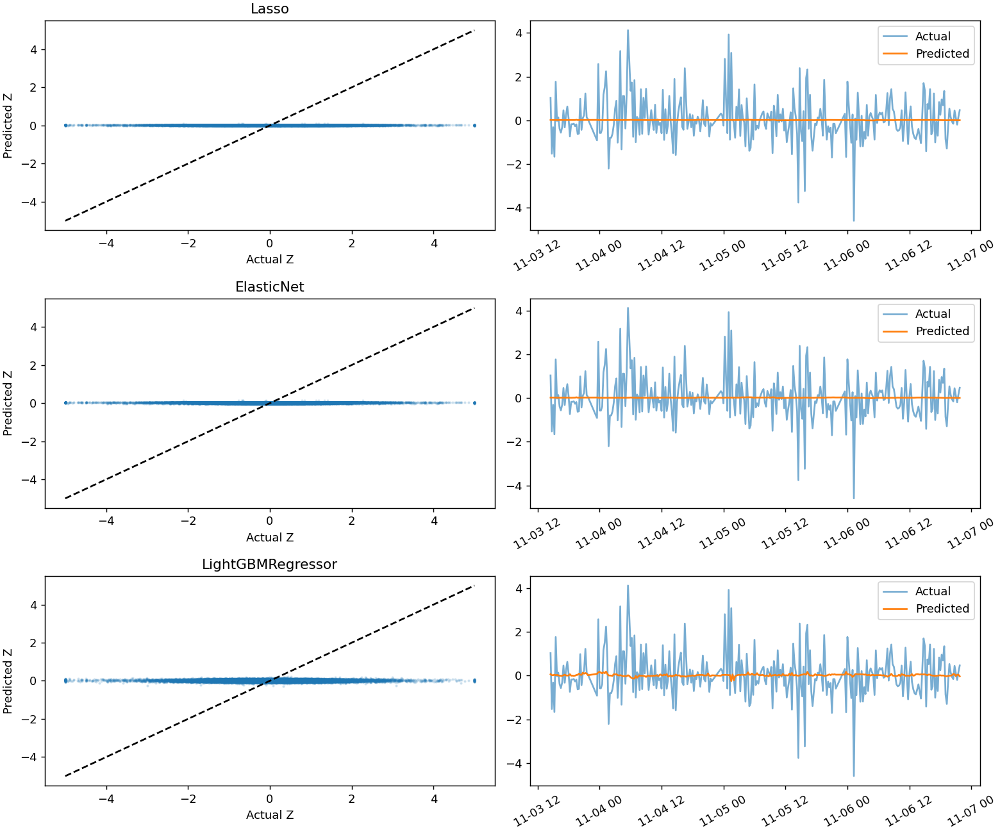

# GLD965 15m direction model: waterfall and tuning

**target:** next contiguous 15m log return / EWMA sigma(t), clipped [-5,5]

**Z_return_lag5:** one-bar log return five observed MTS bars ago / sigma at that historical bar; clipped [-5,5]

**outer_folds:** 4

**embargo_context_bars:** 30

**ewma_half_life:** 30

**null_threshold:** 0.2

**vif_threshold:** 10

**varclus_top_per_cluster:** 3

**permutation_top_max:** 45

**seed:** 42

**selection:** inner training diagnostics; separate chronological selection and tuning blocks inside outer training

**source_lags:** existing source lag fields shifted one additional MTS row: all X ends strictly before decision bar

**near_zero_band:** 0.05

## Validation results

| model             |   R2 vs zero |     MSE |      MAE |   Gain CI low |   Gain CI high |
|:------------------|-------------:|--------:|---------:|--------------:|---------------:|
| ElasticNet        | -0.00025707  | 1.01733 | 0.737434 |  -0.000685646 |    0.000199235 |
| Lasso             | -0.00022468  | 1.0173  | 0.737426 |  -0.000644276 |    0.000221689 |
| LightGBMRegressor | -0.000754187 | 1.01784 | 0.737364 |  -0.00174485  |    0.000179561 |
| zero              |  0           | 1.01707 | 0.737546 | nan           |  nan           |

## Waterfall survivors per fold

| stage                            |   1 |   2 |   3 |   4 |
|:---------------------------------|----:|----:|----:|----:|
| 1 strictly lagged inputs         | 196 | 196 | 196 | 196 |
| 2 null >=20%                     | 129 | 133 | 139 | 166 |
| 3 zero variance                  | 123 | 127 | 133 | 160 |
| 4 VARCLUS top 3 per cluster      |  79 |  77 |  78 | 102 |
| 5 iterative VIF >10              |  48 |  54 |  58 |  65 |
| 6 Lasso permutation top up to 45 |  45 |  45 |  45 |  45 |

## Findings and next steps

All three fitted models have negative pooled R² versus zero and improvement intervals spanning zero. None passes the acceptance rule; the pairwise improvement intervals also span zero. Keep zero as the accepted direction baseline. Z_return_lag5 survives in all four final 45-feature sets, but this does not establish standalone predictive value. Lasso and Elastic Net rarely exceed the 0.05 Z near-zero band, so their conditional direction accuracies rest on very few observations. LightGBM covers about 28% of validation rows at roughly 52% conditional direction accuracy without a reliable MSE improvement. Review feature-selection stability and source availability before further tuning; test any revised selection in nested folds or a later untouched period. Plot timestamps are UTC.

## Interpretation and limitations

Four outer TimeSeriesSplit folds are untouched during their feature selection and tuning. Within each outer training window, the first 60% fits diagnostics, EWMA seed, imputation and scaling; the next 20% ranks Lasso permutation importance; the final 20% chooses hyperparameters. Thirty context bars separate blocks. Selected features and hyperparameters are then refitted on outer training only. EWMA is reseeded on outer training; source rows and contiguous-label boundaries are preserved. Historical lag Z is recomputed within each fold.

VARCLUS ranks by ascending R-squared ratio, taking up to three per cluster. VIF removes the largest value above 10 repeatedly. Permutation retains up to 45 even if fewer survive or some importances are nonpositive; forcing 45 would reverse earlier drops. The selection Lasso uses fixed alpha 0.01, 20 block permutations of 30 observations.

MSE, MAE, R² versus zero, conditional directional accuracy and coverage are reported. Bootstrap confidence intervals use 1,000 paired 30-observation blocks within folds; retain skill only when the lower improvement bound exceeds zero. Pairwise advantage is positive when the first model has lower MSE; comparisons are exploratory without multiplicity correction.

Daily macro release timestamps remain assumed historical availability. Results span 2025–2026 and provide development evidence. There is no untouched final test after inspecting these outcomes. No volatility model is fitted. The lag5 input participates in the waterfall and may be removed; its availability does not force inclusion. Original source files are preserved.
